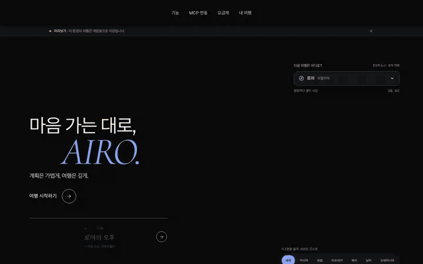
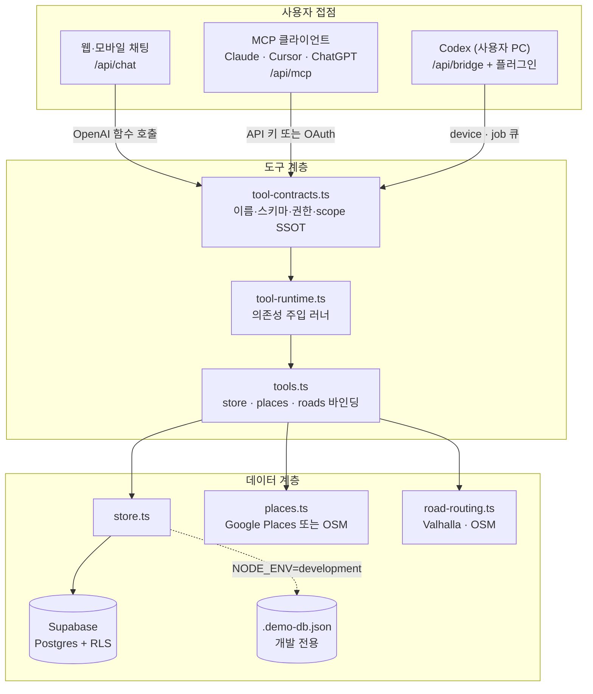
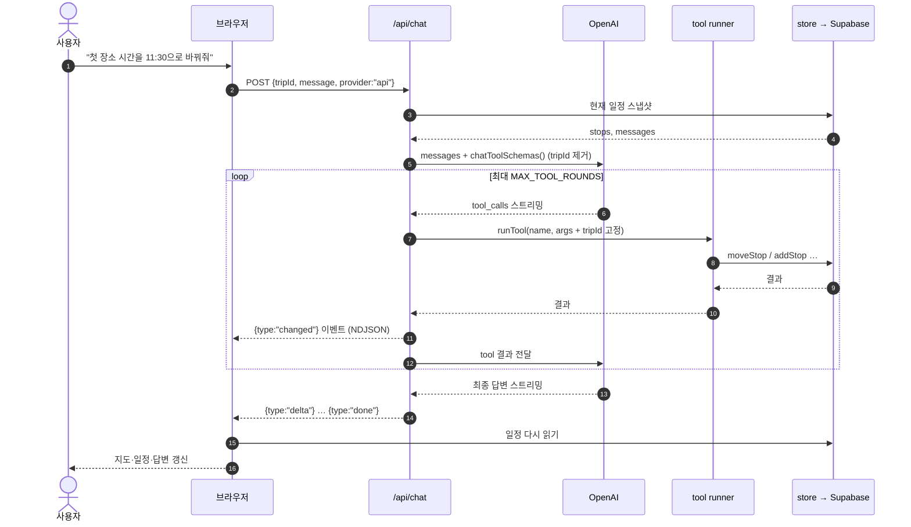
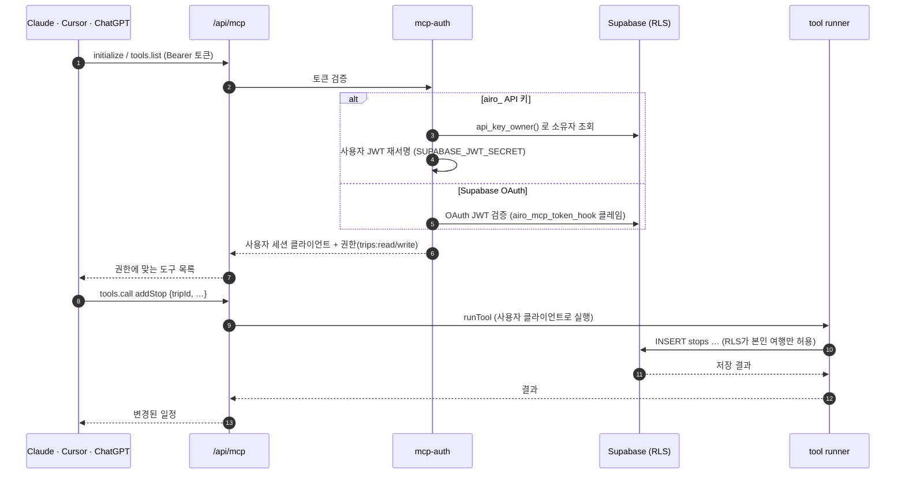
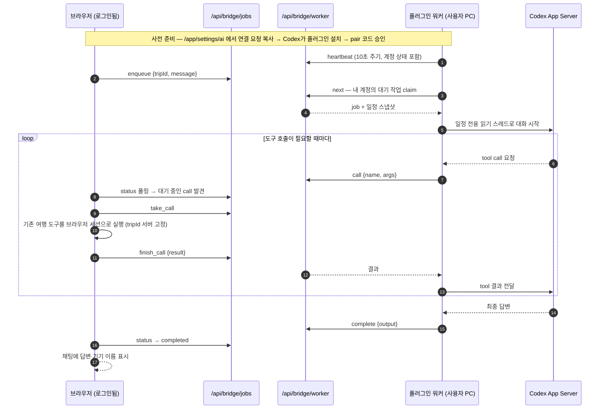

# AIRO — Personal AI Roadmap Orchestrator

**아이로(AIRO)** 는 *AI Roadmap Orchestrator* 의 줄임말입니다. 여행이라는 개인의 로드맵을 여러 AI 도구가 함께 편집하도록 조율하는 서비스입니다.

> 어디로든, AI와 함께.

떠오른 생각을 대화로 던지면 일정이 됩니다. 그 일정은 지도 위 실제 도로를 따라 그려지고, 저장한 장소와 예약 자료, 예산이 일정 곁에 모입니다. 웹뿐 아니라 Claude, Cursor, Codex, ChatGPT 어디에서든 같은 여행을 보고 고칠 수 있습니다.

운영 주소: https://airo.dev-heptivision.com

## 실제 동작



위 영상은 개발 서버의 데모 저장소에서 Playwright로 녹화한 것입니다. AI 호출 없이 실행되는 부분만 담았습니다. 순서는 이렇습니다.

1. 랜딩 지구본에서 로마를 고른다. 지구본은 5초마다 보이는 도시를 하나씩 옮겨 다니며(영상에서는 바르셀로나), 도시 일정 미리보기와 하단 섹션이 따라 바뀐다.
2. 여행 작업 화면에서 "전체 경로 따라가기"를 누른다. 이동 점이 OSM 실제 도로 위를 움직인다.
3. "주변 카페"로 지도 근처 장소를 찾아 1일차에 추가한다.
4. 예산 화면에서 숙소 지출을 적는다.

고화질 파일: [assets/demo/airo-demo.mp4](assets/demo/airo-demo.mp4). 직접 눌러보려면 운영 주소에서 로그인하거나 아래 [시작하기](#시작하기)대로 데모 서버를 띄우면 됩니다.

## 컨셉

"Personal AI Roadmap Orchestrator"는 세 낱말이 각각 설계 결정 하나씩을 가리킵니다.

| 키워드 | 뜻 | 구현 |
| --- | --- | --- |
| **Personal** | 여행은 계정 단위의 개인 자산이다. 데모나 공용 파일이 아니라 로그인한 사용자에게 귀속된다. | Supabase Auth와 테이블 전체 RLS(Row Level Security). 가져온 원본(PDF·예산·즐겨찾기)은 해시로 보존하고 임의로 고치지 않는다. |
| **Roadmap** | 일정은 목록이 아니라 시간과 공간 위의 경로다. | 일차·시간·좌표를 가진 stop 모델, OSM 실제 도로 geometry, 도로를 따라 움직이는 이동 재생. |
| **Orchestrator** | 하나의 여행을 여러 AI 도구가 같은 규약으로 편집한다. AIRO는 도구 사이의 조율자다. | 도구 계약 하나(`tool-contracts.ts`)를 웹 채팅·MCP 서버·Codex 브리지가 공유한다. 어느 도구에서 바꿔도 같은 여행에 반영된다. |

## 무엇을 할 수 있나

- **대화가 일정이 된다.** "로마에서 느긋하게 걷고, 카페에도 들르고 싶어" 같은 요청이 시간별 일정으로 만들어지고 같은 대화에서 순서·시간·장소를 다시 고칠 수 있다.
- **지도와 동선.** 날짜별 경로와 번호 핀, 장소 사진 카드, 실제 도로를 따르는 이동 재생. 지도 주변의 맛집·카페·숙소를 검색해 바로 일정에 넣거나 즐겨찾기로 저장한다.
- **여행 자료 보관.** 저장한 장소, 예약 PDF, 예산(숙소·식비·교통), 예약·결제 상태를 여행 단위로 정리하고 장소 상세에 연결한다. 가져온 원본은 SHA-256으로 보존한다.
- **선택형 일정.** 점심·저녁처럼 한 칸에 후보 2~8곳을 묶어 두고 경로를 비교한 뒤 사용자가 고르면 확정한다. AI가 임의로 확정하지 않는다.
- **변경 이력과 되돌리기.** 일정·여행 정보·PDF·예산·예약·알림 변경이 이력으로 남고, 이후 같은 자료가 바뀌지 않았다면 되돌릴 수 있다.
- **AI 도구 연동.** MCP(Model Context Protocol) 서버로 Claude·Cursor·ChatGPT 같은 외부 클라이언트가 계정 여행을 읽고 편집한다. Codex 사용자는 자기 컴퓨터를 브리지로 연결해 웹·모바일 채팅을 자기 Codex 구독으로 처리한다.
- **모바일 우선.** 접기·반 펼치기·펼치기가 되는 일정 시트. 320px부터 검증한 레이아웃. 설치형 PWA와 별도로 Kotlin·Jetpack Compose 네이티브 Android 앱([android/](android/README.md))이 같은 서버의 여행·예산·자료를 공유한다.

## 구조

세 접점이 도구 계층 하나를 공유하고 도구 계층은 저장소 하나를 본다.



**도구 29개**(조회 13 · 편집 16)가 모든 접점에 같은 이름으로 노출됩니다. 정의는 `src/lib/tool-contracts.ts` 한 곳에 있습니다.

| 영역 | 도구 |
| --- | --- |
| 여행 | `listTrips` `getTrip` `createTrip` `updateTrip` `deleteTrip` |
| 장소·동선 | `searchPlaces` `addStop` `moveStop` `removeStop` `reorderDay` `getDayRoute` `searchAlongRoute` |
| 선택형 일정 | `addChoiceStop` `setStopChoices` `selectStopChoice` |
| 자료 | `listSavedPlaces` `listDocuments` `getDocument` `attachDocument` |
| 예약·예산 | `getReservations` `setReservation` `getBudget` `addBudgetEntry` `updateBudgetEntry` |
| 알림 설정 | `getNotificationSettings` `updateNotificationSettings` (설정 보관만, 발송 없음) |
| 변경 이력 | `listChanges` `getChange` `revertChange` |

트립 채팅에서는 서버가 `tripId`를 고정하고 MCP에서는 `trips:read` / `trips:write` 권한으로 노출 범위를 나눕니다. 실제 예약·결제나 URL 다운로드·OCR은 어떤 도구도 실행하지 않습니다.

### 흐름 1 — 웹 채팅에서 일정이 바뀌기까지



`provider:"api"` 를 명시한 요청만 OpenAI를 부릅니다. 기본값은 사용자의 Codex 브리지이며 서버가 임의로 유료 호출을 대신하지 않습니다.

### 흐름 2 — 외부 AI 도구가 MCP로 편집하기



`service_role` 키는 어디에도 쓰지 않습니다. MCP 요청은 항상 "그 사용자 본인"의 JWT로 실행되므로 RLS가 그대로 적용됩니다. OAuth 연결은 `/app/connect` 승인 화면과 `.well-known/oauth-protected-resource` 메타데이터로 완성됩니다.

### 흐름 3 — 사용자의 Codex가 웹 채팅을 처리하기



AIRO 서버는 OpenAI 토큰을 받지 않습니다. 기기 비밀은 사용자 PC의 로컬 파일에만 있고 DB에는 SHA-256만 저장합니다. 도구는 워커가 아니라 로그인한 브라우저가 실행하므로 편집 권한은 끝까지 사용자 세션에 묶입니다.

## 두 가지 에디션

| | **Cloud** | **Community (self-hosted)** |
| --- | --- | --- |
| 어디서 | https://airo.dev-heptivision.com | 내 서버. `docker compose up -d` |
| 계정 | 이메일·Google 로그인 | 소유자 1명, 비밀번호 |
| 저장소 | Supabase | 내 PostgreSQL + PostgREST |
| AI | 서버 키 또는 내 Codex | 내 OpenAI 키 또는 내 Codex |
| MCP | API 키 + OAuth | API 키 |
| 요금 | 무료 여행 3개, 유료 플랜 예정 | 없음. 한도 없음 |
| 라이선스 | 코어 AGPL-3.0 + `src/ee/` 상용 | AGPL-3.0 |

같은 저장소, 같은 커밋, 같은 SQL입니다. 환경변수 `NEXT_PUBLIC_AIRO_EDITION=community` 하나로 갈립니다. 설치는 [SELF_HOSTING.md](SELF_HOSTING.md).

## 기술 스택

Next.js 16 · React 19 · TypeScript · Kotlin·Jetpack Compose (Android) · Tailwind CSS 4 · Supabase (Auth, Postgres, RLS) · MapLibre GL · OpenAI API · `@modelcontextprotocol/sdk` · GSAP/Motion/Lenis · Playwright

## 시작하기

```sh
npm ci
npm run dev        # http://localhost:3002
```

Supabase 설정이 없으면 개발 서버는 `.demo-db.json` 파일 저장소로 동작합니다. 운영 빌드에서는 이 경로가 닫힙니다. 실제 계정 기능을 쓰려면 `.env.local.example`을 참고해 `NEXT_PUBLIC_SUPABASE_URL`, `NEXT_PUBLIC_SUPABASE_ANON_KEY`, `NEXT_PUBLIC_SITE_URL`을 넣고 `supabase/migrations/0001~0016`를 순서대로 적용합니다.

| 목적 | 명령 |
| --- | --- |
| 빌드 / 린트 | `npm run build` · `npm run lint` |
| 운영 빌드와 분리해 검증 | `NEXT_DIST_DIR=.next-check npm run build` |
| 도구 계약·DB·API 통합 | `npm run test:database` · `npm run test:integration` (전용 테스트 DB 필요) |
| MCP | `npm run test:mcp:local` |
| Codex 브리지 | `npm run test:codex` · `npm run plugin:build` · `npm run plugin:package` |
| 랜딩·모바일 | `npm run test:landing` · `npm run test:mobile` |

테스트는 프레임워크 없이 `scripts/test-*.mjs` 단일 스크립트입니다. 전제 조건과 전체 목록은 [OPERATIONS.md](OPERATIONS.md)에 있습니다.

## 문서

| 문서 | 내용 |
| --- | --- |
| [OPERATIONS.md](OPERATIONS.md) | 개발·운영 연결·개인 자료 이식·검증 절차 |
| [SELF_HOSTING.md](SELF_HOSTING.md) | Community Edition을 내 서버에 docker compose로 올리기 |
| [docs/ops/DEPLOYMENT.md](docs/ops/DEPLOYMENT.md) | Cloud 운영 배포 기록과 현재 값 |
| [AUTH_SETUP.md](AUTH_SETUP.md) | Supabase Auth·Google 로그인 설정 |
| [MCP_SETUP.md](MCP_SETUP.md) · [MCP_IMPLEMENTATION.md](MCP_IMPLEMENTATION.md) | MCP 서버 설정과 구현 |
| [CODEX_CONNECTION.md](CODEX_CONNECTION.md) | Codex 브리지 구조와 계정 경계 |
| [BRAND.md](BRAND.md) · [DESIGN.md](DESIGN.md) | 로고·색상·화면 기준 |
| [docs/ops/UNIFICATION.md](docs/ops/UNIFICATION.md) · [docs/ops/COMMERCIAL_SERVICE.md](docs/ops/COMMERCIAL_SERVICE.md) | 개인 서비스에서 계정형 서비스로 옮긴 기록 |

## 상태

결제와 공개 공유는 아직 없습니다. Cloud 무료 플랜은 여행 3개입니다. Codex 플러그인의 공식 디렉터리 등록은 진행 중이며 지금은 Git 마켓플레이스 설치를 제공합니다.

## 라이선스

코어는 [AGPL-3.0](LICENSE)입니다. 내 서버에 올려 쓰는 데 아무 제한이 없고, 이 코드를 고쳐 남에게 서비스로 제공하면 그 소스도 공개해야 합니다. `src/ee/`(호스팅 플랜·결제)는 [별도 상용 라이선스](src/ee/LICENSE)이며 Community Edition에서는 비활성입니다.
