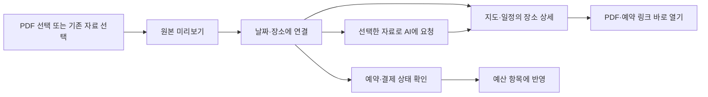

# 최신 AIRO 기준 Android UI·기능 점검

> 이 문서는 0.2.0 당시의 점검 이력이다. 최신 사용자 지시와 0.3.2 구현은 [웹 UI 반영 기록](ANDROID_WEB_PARITY.md)을 따른다. 기존 웹 UI를 기준으로 네이티브 동작을 맞추며, 이 문서의 초기 독자적인 재구성 제안은 이후 지시로 대체됐다.

2026-09-18 사용자 요청: 최신 AIRO의 UI/UX를 기준으로 앱 방향을 맞추고, 자료 업로드 등 이미 있는 기능을 활용한다.

현재 Android 0.2.0은 로그인·일정·예산·자료 열기·구독 대화의 기본 경로를 제공하지만, 최신 운영 웹의 장소별 자료 연결과 사용 흐름은 충분히 반영하지 못했다. 인증·SMTP 설정 완료와 최신 웹 기능의 앱 반영 완료는 별개다. 이 문서는 실제 화면·서버 응답·소스 대조 결과이며, 아래 개선안을 APK에 적용한 상태는 아니다.

## 확인한 기준

- 운영 웹: `stop-attachments-20260918-final`, 장소별 PDF·예약 링크와 PDF 모달 미리보기를 포함한 2026-09-18 버전.
- Aside의 로그인된 운영 화면에서 전체 지도, 날짜 카드, 장소 관련 PDF 미리보기, 자료 페이지를 확인했다. 지도 화면은 920×840, 자료 페이지는 1440×900에서 관찰했다.
- Android: 0.2.0 소스와 기존 320dp 검증 화면을 비교했다. 이번 점검에서 앱을 다시 빌드하거나 실제 계정 E2E를 수행하지 않았다.
- 운영 여행 한 건을 읽기 전용으로 확인했다. PDF 15개 중 12개가 장소에 연결돼 있었고, 구조화된 예약 항목은 0개였다. 메모의 예약·결제 문구와 예약 데이터는 구분해야 한다. 이 표본을 모든 여행의 상태로 일반화하지 않는다.
- 자료 페이지에는 PDF 미리보기 15개와 저장 장소 282개가 표시됐다. 파일 선택 입력은 즐겨찾기 JSON 가져오기이며, PDF 직접 첨부 입력은 없었다.
- 운영 여행·예약·PDF 원본을 수정하지 않았다. AI·OCR·메일 발송·별도 과금 API 호출은 실행하지 않았다. 개인 문서 화면과 예약번호는 이 문서에 첨부하지 않는다.

## 이어갈 UI 방향

최신 웹처럼 **전체 지도 → 오늘과 가까운 날짜 카드 → 장소 선택 → 그 장소의 예약·자료**가 기본 흐름이다. 지도 위치와 선택한 날짜를 유지하면서 필요한 조작부와 상세 화면을 겹쳐 연다. 기존 검정·Air Blue·제비 로고를 그대로 사용한다.

Android는 현재 제목·날짜 칩을 상단에 고정하고, 일정 시트를 화면 높이의 약 36%(180–320dp)로 항상 표시한다. 320dp 검증 화면에서도 지도에 쓸 수 있는 영역이 작다. 최신 웹의 전체 지도와 작은 날짜 카드로 구조를 맞추는 것이 우선이다.

| 화면 | 적용할 흐름 |
| --- | --- |
| 여행 진입 | 오늘 또는 가장 가까운 여행 날짜를 선택하고 전체 지도를 보여준다. |
| 날짜 카드 | 실제 날짜·오늘 표시·장소 수, 이전/다음 버튼과 카드 영역의 좌우 스와이프. 지도 이동 제스처와 분리한다. |
| 장소 상세 | 시간·주소·예약/결제 상태 요약 → PDF·예약 열기·길찾기 → 접을 수 있는 상세 메모 순서. |
| 자료 | PDF·예약·저장 장소를 구분하고 날짜/장소로 찾을 수 있게 한다. 연결되지 않은 전체 여행 자료도 접근 가능하게 둔다. |
| 자료 추가 | 자료 화면과 장소 상세에서 `자료 추가`를 제공한다. 장소에서 시작하면 해당 장소가 미리 선택된다. |
| 예산 | 예약의 금액·결제 상태를 확인하면서 지출로 연결한다. 중복 등록을 확인하고 예약 상태와 결제 상태를 별도로 유지한다. |
| AI 대화 | 보고 있는 날짜·장소·선택 자료를 전달하고 처리 결과에 해당 장소/문서로 돌아가는 동작을 제공한다. |

현재 웹 자료 화면도 긴 파일명 목록이 먼저 화면을 채우고 저장 장소가 그 아래에 놓인다. 앱에서는 문서 이름만 길게 나열하는 구조를 그대로 옮기지 않는다. 예를 들어 `숙소 예약 · 9/19–9/20 · PDF`처럼 사용자가 찾는 정보를 먼저 보여주고 원본 파일명은 상세에서 확인한다. 파일명만으로 연결 관계나 예약 확정을 추측하지 않는다.

## 이미 있는 기능과 앱의 차이

| 기능 | 운영 웹·서버 | Android 0.2.0 | 필요한 연결 |
| --- | --- | --- | --- |
| 장소별 첨부 | 여행 응답의 `attachments`, `stopIds`, 예약 문서 해시 연결 | `TripDetail`에 `attachments`가 없어 수신 정보를 사용하지 않음 | 문서·예약 모델과 장소 상세 UI |
| PDF 보기 | 인증된 원본, SHA-256 주소, 앱 화면 위 PDF 모달 | 숫자 인덱스로 다운로드 후 외부 PDF 앱 실행 | 해시 기준 조회·앱 내부 미리보기·복귀 위치 유지 |
| PDF 올리기 | `attachDocument` 도구와 저장·검증·중복 방지 구현 | 직접 PDF 선택/첨부 화면 없음 | 파일 선택 → 미리보기 → 장소 연결 → 업로드 상태 |
| 예약 관리 | `getReservations`/`setReservation`, 예약 링크·상태·결제 상태·revision | 별도 예약 모델·조회/편집 화면 없음 | 동일 저장 경로를 쓰는 모바일 API와 예약 화면 |
| 예산 | 수동 입력·통화·결제 여부·예비비·revision 충돌 처리 | 기본 예산 기능 있음 | 자료/예약에서 접근하는 흐름과 중복 방지 |
| 변경 이력 | 조회·상세·충돌을 확인하는 되돌리기 도구 | 사용자 화면 없음 | 최근 변경 결과와 되돌리기 진입점 |
| 저장 장소 | 사진·웹사이트·일차/이름 검색·지도·즐겨찾기 | 기본 텍스트 목록·즐겨찾기·일정 추가 | 기존 부가 정보를 활용하는 장소 카드 |
| AI 작업 | MCP 도구 25개, 구독 bridge가 같은 여행 도구 실행 | 텍스트 대화만 입력 가능 | 첨부를 먼저 저장하고 문서 식별자를 대화 맥락에 연결 |
| 외부 공유 받기 | 예약 HTTPS 링크와 PDF 저장 기반 | Manifest에 공유 받기 `ACTION_SEND` 없음 | 후속 단계에서 PDF·텍스트 링크 공유 수신 |
| 알림 | 설정 저장과 `delivery: not_configured` | 발송 기능 없음 | 설정 저장을 실제 푸시 발송 완료로 표시하지 않음 |

서버 도구가 있다는 것과 사용자가 휴대폰에서 파일을 선택해 올릴 수 있다는 것은 구분한다. 현재 지원 기반은 PDF와 AIRO JSON이다. 사진·스캔·이미지 영수증 업로드, OCR, 자동 정보 추출은 별도 확장이 필요하다.

## 자료를 실제로 활용하는 경로

예시: 숙소 예약 PDF를 추가하고 숙박 날짜와 장소를 선택한다. 저장 후 해당 날짜의 숙소 카드에서 PDF와 예약 링크를 바로 연다. 연박이면 여러 장소에 같은 문서를 연결할 수 있다. 같은 숙소를 다시 방문한 다른 예약은 날짜와 명시된 연결로 구분한다. 금액을 예산에 반영할 때는 기존 지출을 확인하고 사용자가 저장할 내용을 검토한다.

AI가 필요한 정리는 연결된 구독 세션을 사용한다. 파일 원본을 매번 대화 입력에 붙이지 않고 저장된 문서의 식별자를 사용한다. 원본 처리·분석이 아직 연결되지 않았으면 자동 추출됐다고 표시하지 않는다. 별도 과금 API와 유료 fallback은 승인 없이 추가하지 않는다.

## 구현 순서와 완료 조건

1. **전체 지도와 장소 상세부터 정렬한다.** 날짜 카드·지도 조작부·선택 유지와 함께 서버의 기존 첨부 데이터를 읽는다. 이미 연결된 PDF가 재업로드 없이 올바른 장소에서 보여야 한다. 같은 숙소의 다른 날짜 문서가 섞이면 완료가 아니다.
2. **PDF 추가와 앱 내부 열기를 연결한다.** 자료 화면/장소 상세의 동일한 추가 흐름, 파일 선택 취소·진행·실패·재시도, 중복 파일 처리, 장소 선택을 구현한다. 파일당 2 MiB·여행당 20개·전체 자료 8 MiB라는 현재 서버 한도를 선택 단계에 알려준다.
3. **예약·예산·변경 이력을 연결한다.** 예약 데이터가 없으면 미등록으로 표현하고 메모 내용으로 확정 상태를 만들어내지 않는다. 저장 전 revision 충돌을 처리하고 변경 결과에서 관련 자료로 돌아갈 수 있게 한다.
4. **AI와 외부 공유를 연결한다.** 기존 자료를 선택해 요청하고, 처리된 자료·변경된 일정으로 이동한다. 이후 PDF·예약 링크 공유 수신을 추가한다. 사진/스캔은 지원 저장 형식과 분석 경로를 정한 다음 확장한다.

각 단계는 320dp/390dp, 큰 글자, 뒤로 가기·앱 재실행·세션 만료에서 확인한다. PDF 뷰어가 없는 휴대폰에서도 앱 내부 열기가 가능해야 한다. 자료 추가 후 웹과 앱의 동일한 장소에서 반영되고, 다른 계정의 원본을 읽을 수 없어야 한다. 자료 원본·장소 연결·예약 상태가 가져오기/내보내기를 거쳐 유지되는지도 확인한다.

## 구현 시 재사용할 코드

- 웹 화면 기준: `src/components/trip-workspace.tsx`, `stop-attachment-actions.tsx`, `pdf-preview.tsx`, `trip-resources.tsx`, `src/lib/trip-calendar.ts`.
- 저장·권한·검증 기준: `src/lib/trip-attachments.ts`, `trip-attachments-store.ts`, `trip-management-store.ts`, `tool-contracts.ts`, `supabase/migrations/0010_trip_management.sql`, `0011_stop_attachments.sql`.
- 앱 시작점: `android/app/src/main/java/com/heptivision/airo/core/model/Models.kt`, `Resources.kt`, `feature/itinerary/ItineraryScreen.kt`, `feature/resources/ResourcesScreen.kt`, `data/trips/TripRepository.kt`.
- 모바일 인증 경계: `src/lib/mobile-api-path.ts`는 현재 문서의 숫자 인덱스만 허용한다. 해시 주소와 자료 저장 API를 추가할 때 필요한 경로·메서드만 열고 기존 사용자 JWT/RLS를 유지한다.
- 보관 파일: Android의 `ArchiveFile.data`는 `JsonObject`로 보존된다. 화면 모델에 새 필드가 없다는 사실을 곧바로 내보내기 데이터 유실로 단정하지 않는다. 실제 왕복 보존 검사로 확인한다.

이번 점검으로 APK나 운영 기능을 변경하지 않았다. 새 기준의 차이와 구현 순서를 기록했고, 0.2.0의 E2E 문구에서 PDF 직접 업로드가 이미 가능한 것처럼 보이는 부분을 수정했다.
